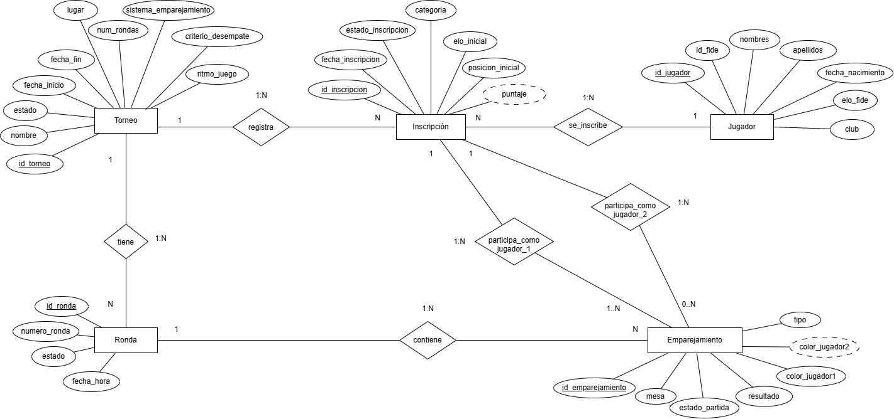
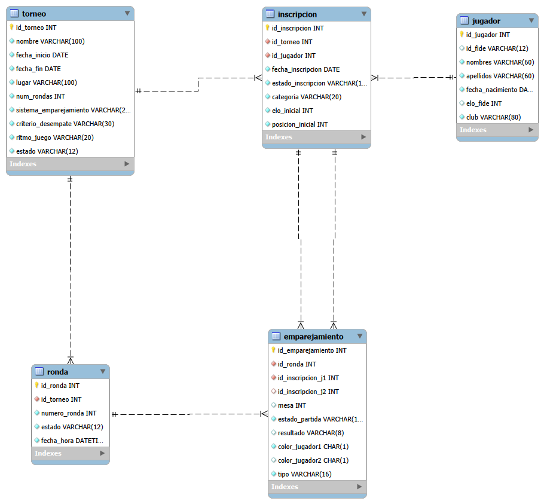
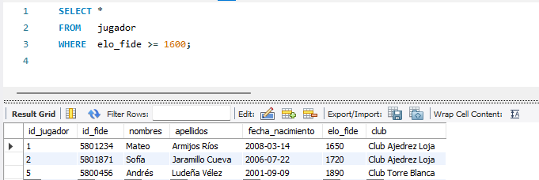
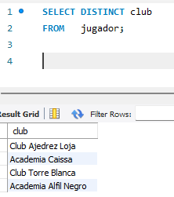
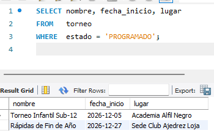
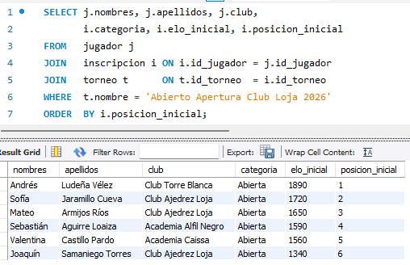
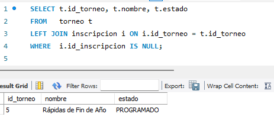

# ♟️ Sistema de Gestión de Torneos de Ajedrez

> Diseño de una base de datos relacional para la gestión de torneos de ajedrez en clubes y academias, basada en el reglamento FIDE.

| | |
|---|---|
| **Asignatura** | Base de datos |
| **Carrera** | Computación — FEIRNNR |
| **Ciclo / Unidad** | 3 A / Unidad 1 |
| **Docente** | Edwin René Guamán Quinche |
| **Autora** | Alison Micaela Tapia Morocho |
| **SGBD** | MySQL 8.0 o superior |

## 📑 Contenido

1. [Descripción del proyecto](#-descripción-del-proyecto)
2. [Diagrama Entidad-Relación](#-diagrama-entidad-relación)
3. [Modelo relacional](#-modelo-relacional)
4. [Código SQL de las tablas](#-código-sql-de-las-tablas)
6. [Consultas](#-consultas)

## 📖 Descripción del proyecto

Los clubes de ajedrez y las academias organizan torneos internos y encuentros amistosos que se rigen por las normas de la FIDE: sistema de emparejamiento, ritmo de juego, puntuación (1 punto por victoria, ½ por tablas y 0 por derrota) y criterios de desempate. Plataformas como Chess-Results publican los resultados, pero dependen de programas de pago como Swiss-Manager, poco accesibles para clubes pequeños, que terminan usando hojas de cálculo o registros manuales.

Esta base de datos permite registrar de forma ordenada, consistente y de bajo costo:

- **Torneos**: nombre, fechas, lugar, número de rondas, sistema de emparejamiento, ritmo de juego y criterio de desempate.
- **Jugadores**: identificación FIDE, nombres, apellidos, fecha de nacimiento, Elo FIDE y club.
- **Inscripciones**: participación de cada jugador en cada torneo (categoría, Elo inicial, posición inicial y puntaje).
- **Rondas y emparejamientos**: mesa, colores, tipo de partida (normal, descanso o incomparecencia) y resultado.

Gracias a la integridad referencial se evitan casos como emparejar a un jugador que no está inscrito o registrar rondas sin torneo.

## 🧩 Diagrama Entidad-Relación

El modelo usa la notación de Chen y tiene cinco entidades: **Torneo**, **Jugador**, **Inscripción**, **Ronda** y **Emparejamiento**. La entidad Inscripción resuelve la relación de muchos a muchos entre Jugador y Torneo y guarda los datos propios de cada participación. Los atributos con línea punteada (`puntaje`, `color_jugador2`) son derivados.



## 🗂️ Modelo relacional

Se obtuvo aplicando las reglas de transformación del modelo E-R:

- Cada entidad se convirtió en una tabla con su llave primaria (PK).
- Cada relación 1:N se resolvió llevando la PK del lado 1 como llave foránea (FK) al lado N.
- `emparejamiento` se relaciona dos veces con `inscripcion`, por lo que tiene dos FK (`id_inscripcion_j1` e `id_inscripcion_j2`); la segunda es opcional para representar el descanso.
- `color_jugador2` no se almacena como dato independiente: es una columna generada a partir de `color_jugador1`.



> **Nota:** el diagrama muestra la estructura base de las tablas; la columna `puntaje` de `inscripcion` está definida en el código SQL de abajo.

## 🛠️ Código SQL de las tablas

Cada tabla declara su llave primaria, sus llaves foráneas y las restricciones `NOT NULL`, `UNIQUE`, `DEFAULT` y `CHECK` que protegen la integridad de los datos. Para crearlas sin errores, ejecútalas en este orden (de menor a mayor dependencia):

### 1. `jugador`

Almacena los datos personales y deportivos de cada jugador. `id_fide` es opcional y único; el Elo está restringido entre 0 y 3000.

```sql
CREATE TABLE jugador (
    id_jugador       INT          NOT NULL AUTO_INCREMENT,
    id_fide          VARCHAR(12),
    nombres          VARCHAR(60)  NOT NULL,
    apellidos        VARCHAR(60)  NOT NULL,
    fecha_nacimiento DATE         NOT NULL,
    elo_fide         INT          NOT NULL DEFAULT 0,
    club             VARCHAR(80)  NOT NULL,
    PRIMARY KEY (id_jugador),
    CONSTRAINT uq_jugador_id_fide UNIQUE (id_fide),
    CONSTRAINT ck_jugador_elo CHECK (elo_fide BETWEEN 0 AND 3000)
);
```

### 2. `torneo`

Define cada evento: fechas, lugar, número de rondas, sistema de emparejamiento (`SUIZO` o `TODOS_CONTRA_TODOS`), criterio de desempate, ritmo de juego y estado.

```sql
CREATE TABLE torneo (
    id_torneo              INT          NOT NULL AUTO_INCREMENT,
    nombre                 VARCHAR(100) NOT NULL,
    fecha_inicio           DATE         NOT NULL,
    fecha_fin              DATE         NOT NULL,
    lugar                  VARCHAR(100) NOT NULL,
    num_rondas             INT          NOT NULL,
    sistema_emparejamiento VARCHAR(20)  NOT NULL,
    criterio_desempate     VARCHAR(30)  NOT NULL,
    ritmo_juego            VARCHAR(20)  NOT NULL,
    estado                 VARCHAR(12)  NOT NULL DEFAULT 'PROGRAMADO',
    PRIMARY KEY (id_torneo),
    CONSTRAINT ck_torneo_fechas  CHECK (fecha_fin >= fecha_inicio),
    CONSTRAINT ck_torneo_rondas  CHECK (num_rondas > 0),
    CONSTRAINT ck_torneo_sistema CHECK (sistema_emparejamiento IN ('SUIZO', 'TODOS_CONTRA_TODOS')),
    CONSTRAINT ck_torneo_estado  CHECK (estado IN ('PROGRAMADO', 'EN_CURSO', 'FINALIZADO', 'CANCELADO'))
);
```

### 3. `inscripcion`

Resuelve la relación N:M entre jugador y torneo. Un jugador solo puede inscribirse una vez por torneo (`UNIQUE (id_torneo, id_jugador)`) y guarda su Elo inicial, categoría, posición inicial y puntaje.

```sql
CREATE TABLE inscripcion (
    id_inscripcion     INT           NOT NULL AUTO_INCREMENT,
    id_torneo          INT           NOT NULL,
    id_jugador         INT           NOT NULL,
    fecha_inscripcion  DATE          NOT NULL,
    estado_inscripcion VARCHAR(12)   NOT NULL DEFAULT 'PENDIENTE',
    categoria          VARCHAR(20)   NOT NULL,
    elo_inicial        INT           NOT NULL,
    posicion_inicial   INT           NOT NULL,
    puntaje            DECIMAL(4,1)  NOT NULL DEFAULT 0,
    PRIMARY KEY (id_inscripcion),
    CONSTRAINT uq_inscripcion_torneo_jugador UNIQUE (id_torneo, id_jugador),
    CONSTRAINT fk_inscripcion_torneo  FOREIGN KEY (id_torneo)  REFERENCES torneo (id_torneo),
    CONSTRAINT fk_inscripcion_jugador FOREIGN KEY (id_jugador) REFERENCES jugador(id_jugador),
    CONSTRAINT ck_inscripcion_estado  CHECK (estado_inscripcion IN ('PENDIENTE', 'CONFIRMADA', 'RETIRADA')),
    CONSTRAINT ck_inscripcion_puntaje CHECK (puntaje >= 0),
    CONSTRAINT ck_inscripcion_posicion CHECK (posicion_inicial > 0)
);
```

### 4. `ronda`

Cada ronda pertenece a un torneo y su número es único dentro de él.

```sql
CREATE TABLE ronda (
    id_ronda     INT         NOT NULL AUTO_INCREMENT,
    id_torneo    INT         NOT NULL,
    numero_ronda INT         NOT NULL,
    estado       VARCHAR(12) NOT NULL DEFAULT 'PROGRAMADA',
    fecha_hora   DATETIME    NOT NULL,
    PRIMARY KEY (id_ronda),
    CONSTRAINT uq_ronda_torneo_numero UNIQUE (id_torneo, numero_ronda),
    CONSTRAINT fk_ronda_torneo FOREIGN KEY (id_torneo) REFERENCES torneo (id_torneo),
    CONSTRAINT ck_ronda_numero CHECK (numero_ronda > 0),
    CONSTRAINT ck_ronda_estado CHECK (estado IN ('PROGRAMADA', 'EN_CURSO', 'FINALIZADA'))
);
```

### 5. `emparejamiento`

Cada partida de una ronda. Referencia dos inscripciones (`id_inscripcion_j1` e `id_inscripcion_j2`); la segunda es opcional para representar el descanso. `color_jugador2` es una columna generada a partir de `color_jugador1`.

```sql
CREATE TABLE emparejamiento (
    id_emparejamiento INT         NOT NULL AUTO_INCREMENT,
    id_ronda          INT         NOT NULL,
    id_inscripcion_j1 INT         NOT NULL,
    id_inscripcion_j2 INT,
    mesa              INT,
    estado_partida    VARCHAR(12) NOT NULL DEFAULT 'PROGRAMADA',
    resultado         VARCHAR(8),
    color_jugador1    CHAR(1)     NOT NULL,
    color_jugador2    CHAR(1) GENERATED ALWAYS AS (
        CASE WHEN id_inscripcion_j2 IS NULL THEN NULL
             WHEN color_jugador1 = 'B' THEN 'N'
             ELSE 'B' END) VIRTUAL,
    tipo              VARCHAR(16) NOT NULL DEFAULT 'NORMAL',
    PRIMARY KEY (id_emparejamiento),
    CONSTRAINT uq_emparejamiento_ronda_mesa UNIQUE (id_ronda, mesa),
    CONSTRAINT fk_emp_ronda FOREIGN KEY (id_ronda)          REFERENCES ronda (id_ronda),
    CONSTRAINT fk_emp_j1    FOREIGN KEY (id_inscripcion_j1) REFERENCES inscripcion (id_inscripcion),
    CONSTRAINT fk_emp_j2    FOREIGN KEY (id_inscripcion_j2) REFERENCES inscripcion (id_inscripcion),
    CONSTRAINT ck_emp_jugadores_distintos CHECK (id_inscripcion_j1 <> id_inscripcion_j2),
    CONSTRAINT ck_emp_estado    CHECK (estado_partida IN ('PROGRAMADA', 'EN_JUEGO', 'FINALIZADA')),
    CONSTRAINT ck_emp_resultado CHECK (resultado IN ('1-0', '0-1', '1/2-1/2')),
    CONSTRAINT ck_emp_color     CHECK (color_jugador1 IN ('B', 'N')),
    CONSTRAINT ck_emp_tipo      CHECK (tipo IN ('NORMAL', 'DESCANSO', 'INCOMPARECENCIA')),
    CONSTRAINT ck_emp_descanso  CHECK (
        (tipo = 'DESCANSO' AND id_inscripcion_j2 IS NULL) OR
        (tipo <> 'DESCANSO' AND id_inscripcion_j2 IS NOT NULL)),
    CONSTRAINT ck_emp_resultado_final CHECK (
        (estado_partida = 'FINALIZADA' AND resultado IS NOT NULL) OR
        (estado_partida <> 'FINALIZADA' AND resultado IS NULL))
);
```

## 🔍 Consultas

Cada consulta se formula primero en álgebra relacional y luego se traduce a SQL. Se ejecutaron sobre los datos de ejemplo (10 jugadores, 5 torneos, 17 inscripciones, 8 rondas y 21 emparejamientos).

### Consulta 1 — Selección (σ)

**Descripción:** Obtener todos los atributos de los jugadores con Elo FIDE mayor o igual a 1600.

**Álgebra relacional:**

```
σ elo_fide ≥ 1600 (JUGADOR)
```

**SQL:**

```sql
SELECT *
FROM   jugador
WHERE  elo_fide >= 1600;
```

**Resultado:** Tres jugadores cumplen la condición: Mateo Armijos (1650), Sofía Jaramillo (1720) y Andrés Ludeña (1890).



### Consulta 2 — Proyección (π)

**Descripción:** Obtener la lista de clubes a los que pertenecen los jugadores, sin duplicados.

**Álgebra relacional:**

```
π club (JUGADOR)
```

**SQL:**

```sql
SELECT DISTINCT club
FROM   jugador;
```

**Resultado:** Se obtienen 4 filas: Club Ajedrez Loja, Academia Caissa, Club Torre Blanca y Academia Alfil Negro.



### Consulta 3 — Selección con proyección (σ + π)

**Descripción:** Obtener el nombre, la fecha de inicio y el lugar de los torneos que todavía están programados.

**Álgebra relacional:**

```
π nombre, fecha_inicio, lugar (σ estado = 'PROGRAMADO' (TORNEO))
```

**SQL:**

```sql
SELECT nombre, fecha_inicio, lugar
FROM   torneo
WHERE  estado = 'PROGRAMADO';
```

**Resultado:** Se listan los dos torneos programados: Torneo Infantil Sub-12 y Rápidas de Fin de Año.



### Consulta 4 — Reunión natural / JOIN (⋈)

**Descripción:** Listar los jugadores inscritos en el torneo «Abierto Apertura Club Loja 2026», con su categoría, Elo inicial y posición inicial.

**Álgebra relacional:**

```
π nombres, apellidos, club, categoria, elo_inicial, posicion_inicial (σ nombre = 'Abierto Apertura Club Loja 2026' (JUGADOR ⋈ INSCRIPCION ⋈ TORNEO))
```

**SQL:**

```sql
SELECT j.nombres, j.apellidos, j.club,
       i.categoria, i.elo_inicial, i.posicion_inicial
FROM   jugador j
JOIN   inscripcion i ON i.id_jugador = j.id_jugador
JOIN   torneo t      ON t.id_torneo  = i.id_torneo
WHERE  t.nombre = 'Abierto Apertura Club Loja 2026'
ORDER  BY i.posicion_inicial;
```

**Resultado:** Seis filas, una por jugador inscrito, ordenadas por posición inicial.



### Consulta 5 — Reunión externa (σ + π + ⟕)

**Descripción:** Encontrar los torneos que no tienen ninguna inscripción.

**Álgebra relacional:**

```
π id_torneo, nombre, estado (σ id_inscripcion es NULL (TORNEO ⟕ INSCRIPCION))
```

**SQL:**

```sql
SELECT t.id_torneo, t.nombre, t.estado
FROM   torneo t
LEFT JOIN inscripcion i ON i.id_torneo = t.id_torneo
WHERE  i.id_inscripcion IS NULL;
```

**Resultado:** Una sola fila: «Rápidas de Fin de Año», que aún no tiene inscripciones. Con un `INNER JOIN` este torneo no aparecería.



## 📚 Referencias

1. FIDE, «FIDE Handbook». https://handbook.fide.com
2. H. Herzog, «Swiss-Manager». http://swiss-manager.at
3. «Chess-Results.com». https://chess-results.com
4. «Vega». https://www.vegachess.com
5. P. P.-S. Chen, «The entity-relationship model—toward a unified view of data», *ACM Trans. Database Syst.*, vol. 1, n.º 1, pp. 9–36, 1976.
6. R. Elmasri y S. B. Navathe, *Fundamentals of Database Systems*, 7.ª ed. Pearson, 2016.
7. Oracle Corporation, «MySQL 8.0 Reference Manual». https://dev.mysql.com/doc/refman/8.0/en/
